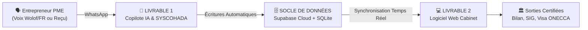
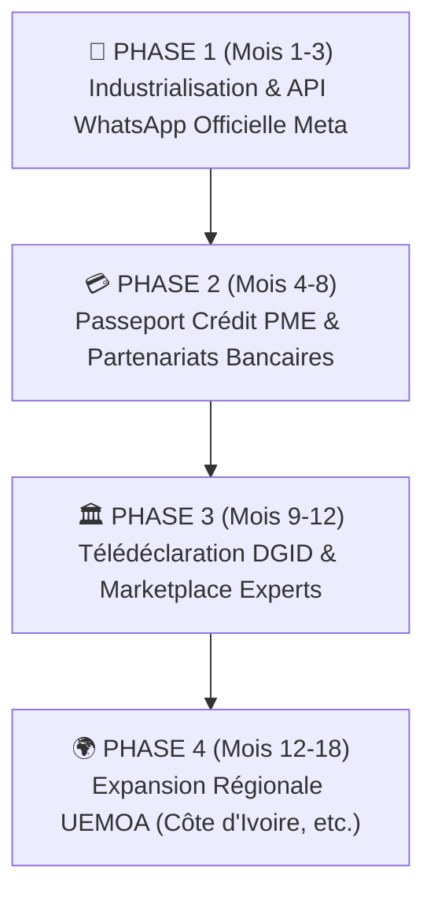

# 📄 Grow — Rapport Exécutif des Livrables & Feuille de Route Investisseurs

**Date :** Novembre 2026  
**Projet :** Grow (Grow-mvp) — Copilote Financier & Assistant Pré-Comptable SYSCOHADA  
**Zone Géographique :** Dakar, Sénégal & Union Économique et Monétaire Ouest-Africaine (UEMOA)  
**Cibles :** PME, Commerçants informels, Dirigeants d'entreprises & Cabinets d'Expertise Comptable (ONECCA)  

---

## 🎯 1. Résumé Exécutif & Proposition de Valeur

### Le Constat du Marché Africain
En Afrique de l'Ouest, et particulièrement au Sénégal, plus de **90% du tissu économique est constitué de PME, commerçants et artisans**. 
* **Le Paradoxe :** Ces entrepreneurs ne tiennent pas de comptabilité formelle par manque de temps, de formation ou d'outils adaptés. En revanche, **100% d'entre eux utilisent quotidiennement WhatsApp, Wave et Orange Money** pour leurs échanges commerciaux.
* **La Conséquence :** Les experts-comptables reçoivent des boîtes à chaussures de reçus en fin d'exercice, les PME sont exclues du crédit bancaire faute d'états financiers certifiés, et les risques de redressement fiscal (DGID) sont majeurs.

### La Solution Grow
Grow transforme WhatsApp en un **copilote comptable intelligent en langage naturel (Français & Wolof)** capable d'alimenter en temps réel un **logiciel web certifié SYSCOHADA Révisé** dédié à l'expert-comptable.

---

## 📦 2. Bilan Rétrospectif : Tout ce qui a été Réalisé pour les 2 Livrables

### 📱 LIVRABLE 1 : Le Copilote Financier WhatsApp & Moteur Vocal IA
*Dossier du projet : `grow_whatsapp/`*

1. **Reconnaissance Vocale & Compréhension Multimodale :**
   * Intégration du modèle multimodal **Google Gemini Flash** pour la transcription et l'analyse audio instantanée, capable d'isoler la voix même avec des bruits de marché ou de circulation dakarois.
   * Modèle vocal complémentaire **Meta MMS Wolof** et synthèse vocale TTS haute définition (EdgeTTS / ElevenLabs) pour répondre à l'utilisateur par message vocal.
2. **Dictionnaire & Normalisation Phonétique Wolof (`wolof_normalizer.py`) :**
   * Moteur linguistique convertissant le vocabulaire commercial et financier informel (*jënd* = achat, *jaay* = vente, *dërëm* = 5 FCFA, *wari/xaalis* = argent, etc.) en concepts SYSCOHADA stricts.
3. **Moteur d'Imputation Comptable SYSCOHADA Révisé (`smart_classifier.py`) :**
   * Affectation automatique et intelligente aux classes de comptes réglementaires :
     * Classe 6 : Achats de marchandises (`601`), Transports (`61`), Loyers (`622`), Télécoms (`638`), Frais bancaires (`631`).
     * Classe 7 : Ventes de marchandises (`701`), Prestations de services (`706`).
     * Classe 5 : Trésorerie (`5213` Wave, `5214` Orange Money, `571` Caisse Espèces, `521` Banque).
4. **Extraction Locale & Déterministe (`local_extractor.py`) :**
   * Moteur regex et NLP local ultra-rapide (< 10 ms) extrayant le montant en FCFA, la date d'opération, le canal de paiement et l'identité du tiers/fournisseur.
5. **Supervision Conversationnelle & Assistant Expert (`conversation_supervisor.py`, `expert_assistant.py`) :**
   * Gestion de dialogue multi-tours pour demander une précision si une information est incomplète.
   * Onboarding fluide en 5 étapes guidant l'entrepreneur vers l'enregistrement de sa PME (Nom, NINEA, secteur).

---

### 💻 LIVRABLE 2 : Le Logiciel Web Expert-Comptable & Direction Financière
*Dossier du projet : `grow_logiciel_comptable/`*

1. **Portail d'Accueil Scandinave Haute Performance :**
   * **Canevas de Points Artistiques 60 FPS (`portalDotsCanvas`)** : Matrice de points dynamiques animée en HTML5 Canvas avec ondulation fluide et répulsion magnétique sous le curseur, conçue selon les codes graphiques épurés des meilleures fintechs mondiales (Stripe, Ramp).
   * **Recherche Multi-Critères Universelle** : Filtrage instantané des entreprises clientes par Nom (ex: CGLT), NINEA ou numéro de téléphone WhatsApp, sans contour bleu parasite.
   * **Vol Cinématique Morphologique** : Transition fluide transportant le logo du portail vers l'en-tête du tableau lors du choix de l'entreprise.
2. **Grand-Livre Général & Tableau Factoo :**
   * Visualisation en temps réel de toutes les écritures comptables enregistrées via WhatsApp ou saisies manuellement.
   * Système de filtres par classe comptable (1 à 8), par statut de certification et par canal de trésorerie.
   * Sélecteur de date sur-mesure complet (avec mois à 6 semaines calibrés sans rognage).
3. **Bilan SYSCOHADA Révisé & Soldes Intermédiaires de Gestion (SIG) :**
   * Présentation bilantielle officielle à deux colonnes (Actif / Passif).
   * **Bandeau de Contrôle de Conformité Bilantielle** avec calcul instantané de l'écart (Actif Net vs Passif Total) pour une détection immédiate des déséquilibres.
   * Calcul en temps réel de la Marge Commerciale, de la Valeur Ajoutée (VA), de l'EBE et du Résultat Net de l'exercice.
4. **Scellement Numérique & Visa ONECCA :**
   * Génération de visa officiel d'expert-comptable avec horodatage déterministe et empreinte cryptographique SHA-256 infalsifiable pour la télédéclaration DGID Sen-E-Tax.
5. **Espaces Dédiés Multi-Dossiers & Abonnements :**
   * `agence.html` : Tableau de bord multi-entreprises pour les collaborateurs de cabinet.
   * `abonnement.html` : Gestion des plans SaaS et intégration des paiements récurrents Wave et Orange Money.

---

### 🗄️ Le Socle Commun & la Résilience des Données
*Dossier du projet : `grow_shared/`*

* **Architecture Hybride Supabase + SQLite :**
  * Supabase Cloud PostgreSQL pour la persistance temps réel et la synchronisation multi-terminaux.
  * Réplique locale SQLite automatique (`grow_compta.db`) assurant qu'**aucun utilisateur ne voit jamais un écran blanc**, même en cas de coupure de réseau internet.
* **Liaison Infaillible Tableaux <-> Base :**
  * Verrous posés pour que l'entreprise principale CGLT et l'ensemble des 5 entreprises de test (36 écritures SYSCOHADA réelles) soient toujours immédiatement accessibles.
* **Expérience Développeur en 1 Commande :**
  * `npm run dev` : Orchestrateur Node.js démarrant à la fois le serveur FastAPI sur `http://localhost:8000` et le tunnel sécurisé.

---

## 🚀 3. Feuille de Route Stratégique Post-Validation Investisseurs

Si les investisseurs valident les 2 livrables actuels, voici le plan de déploiement structuré sur 4 phases opérationnelles (Mois 1 à 18) :

---

### 🟢 Phase 1 : Scale Technique & Intégration Meta Directe (Mois 1 à 3)

| Chantier | Actions Concrètes | Bénéfice PME / Cabinet |
|---|---|---|
| **Passage WhatsApp Cloud API (WABA)** | Migration vers un BSP officiel Meta (360dialog / Twilio Enterprise) avec numéro vérifié et **badge vert officiel Grow**. | Fin des limites de messages, fiabilité 99.99%, délivrabilité instantanée. |
| **OCR Factures & Reçus Thermiques** | Entraînement d'un sous-modèle de vision sur les reçus sénégalais (quittances Senelec, factures Sonatel, tickets de caisse froissés). | L'entrepreneur prend une photo floue, Grow extrait le fournisseur, la TVA (18%) et le montant net. |
| **Tunnel & Infrastructure Cloud Dédiée** | Déploiement sur cluster Kubernetes (AWS / GCP Afrique du Sud / Frankfurt) avec nom de domaine scellé `api.grow.sn`. | Suppression définitive de tout tunnel temporaire de développement. |
| **APIs Marchandes Wave & Orange Money** | Connexion directe aux APIs Wave Business et OM Pro via webhooks marchands. | Rapprochement bancaire 100% automatisé à chaque notification de paiement reçu. |

---

### 🟡 Phase 2 : Passeport Crédit PME & Partenariats Bancaires (Mois 4 à 8)

*Actuellement, 85% des demandes de crédit PME en Afrique sont refusées faute d'états financiers fiables.*

1. **Génération du Score Financier Grow :**
   * Algorithme évaluant la régularité des flux, le taux d'épargne net, la diversification des clients et le ratio d'endettement prudentiel BCEAO (33% du cash-flow libre).
2. **Partenariats Microfinance & Banques (Cofina, Baobab, BNDE, Ecobank) :**
   * Mise à disposition d'une interface bancaire sécurisée où une PME cliente peut autoriser sa banque à consulter son relevé comptable certifié Grow en 1 clic.
   * Réduction du délai d'octroi de crédit de 3 mois à **48 heures**.

---

### 🟠 Phase 3 : Télédéclaration Fiscale & Marketplace ONECCA (Mois 9 à 12)

1. **Intégration Sen-E-Tax (DGID Sénégal) :**
   * Génération en 1 clic de la **Liasse Fiscale SYSCOHADA Révisé** au format officiel exigé par la Direction Générale des Impôts et des Domaines (DGID).
   * Automatisation du calcul de la BRS (Retenue à la source) et de la déclaration de TVA mensuelle.
2. **Marketplace "Mon Expert Grow" :**
   * Plateforme de mise en relation entre les PME sans comptable et les cabinets membres de l'ONECCA.
   * L'expert-comptable dispose d'un portefeuille de dossiers pré-comptabilisés à 80% par l'IA et peut se concentrer sur le conseil à haute valeur ajoutée.

---

### 🔵 Phase 4 : Expansion Régionale UEMOA (Mois 12 à 18)

1. **Déploiement en Côte d'Ivoire (Abidjan) :**
   * 1ère économie de la zone UEMOA, partageant la même monnaie (FCFA XOF) et le même référentiel comptable SYSCOHADA.
   * Intégration des moyens de paiement ivoiriens : Wave CI, Orange Money CI, MTN MoMo, Moov Money.
2. **Support Linguistique Élargi :**
   * Adaptation du moteur vocal pour intégrer le **Nouchi** et le **Dioula** (Côte d'Ivoire), ainsi que le **Bambara** (Mali).
3. **Pénétration Marché :**
   * Objectif : 25 000 PME actives et 150 cabinets comptables partenaires sous 18 mois.

---

## 📊 4. Modèle Économique & Métriques Cibles (Unit Economics)

| Flux de Revenus | Tarification Cible | Cible & Potentiel |
|---|---|---|
| **Abonnement PME (WhatsApp)** | **9 900 à 19 900 FCFA / mois** (15 à 30 €) | 10 000 PME d'ici fin 2027 (~150k € MRR) |
| **Licence Cabinet Expert-Comptable** | **49 000 FCFA / mois** (inclus 15 dossiers PME) | 200 cabinets partenaires |
| **Commission d'Apport d'Affaires Crédit** | **1% à 2%** sur les volumes de prêts débloqués par les banques partenaires | Revenu transactionnel scalable |

---

## 🏆 5. Conclusion pour les Investisseurs

Grow ne demande pas aux entrepreneurs informels d'Afrique de changer leurs habitudes ou d'apprendre un logiciel complexe : **Grow s'adapte à eux, sur l'application qu'ils maîtrisent déjà (WhatsApp), dans la langue qu'ils parlent (Wolof/Français)**.

Les deux livrables développés à ce jour prouvent la faisabilité technique complète de bout en bout :
1. ✅ **Livrable 1 opérationnel :** La note vocale informelle est comprise, traduite et imputée au plan comptable SYSCOHADA.
2. ✅ **Livrable 2 opérationnel :** L'expert-comptable visualise le grand-livre, le bilan et le résultat certifié sur une interface web moderne.
3. ✅ **Socle scellé :** Base Supabase Cloud connectée en direct, résilience locale SQLite et commande universelle `npm run dev`.

*Le capital d'amorçage permettra d'accélérer l'acquisition terrain, d'officialiser la ligne WhatsApp Meta Business et de sceller les premiers partenariats bancaires.*

