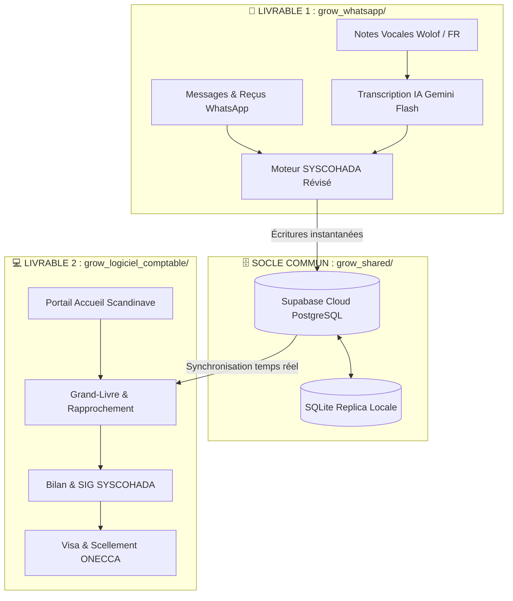

# 🚀 Grow MVP — Copilote Financier & Assistant Pré-Comptable SYSCOHADA (Dakar, Sénégal)

Grow est une solution fintech & pré-comptable conçue pour l'Afrique de l'Ouest (Sénégal / zone UEMOA), connectant les PME et commerçants à leurs experts-comptables via **WhatsApp** et un **Logiciel Web professionnel**.

---

## 🏗️ Architecture Globale en 2 Grands Livrables

Le projet est structuré en deux grands livrables autonomes partageant un socle de données unifié :



---

## 📂 Organisation des Dossiers du Projet

```
Grow-mvp/
│
├── 📁 grow_whatsapp/                # LIVRABLE 1 : Copilote Financier WhatsApp
│   ├── voice_processor.py           # Moteur vocal (MMS Wolof, EdgeTTS, ElevenLabs)
│   ├── gemini_audio_processor.py    # Transcription multimodale Google Gemini Flash
│   ├── wolof_normalizer.py          # Dictionnaire phonétique Wolof -> SYSCOHADA
│   ├── smart_classifier.py          # Règles d'imputation comptable SYSCOHADA
│   ├── local_extractor.py           # Extraction regex & parsing (montants FCFA, dates, tiers)
│   ├── conversation_supervisor.py   # Gestion de dialogue contextuel
│   ├── expert_assistant.py          # Assistant financier conversationnel
│   ├── audio_samples/               # Échantillons audio réels de tests (Wolof & Français)
│   └── README.md                    # Documentation complète du Livrable 1
│
├── 📁 grow_logiciel_comptable/      # LIVRABLE 2 : Logiciel Web Expert-Comptable
│   ├── templates/                   # Interfaces Utilisateur Web Jinja2
│   │   ├── dashboard.html           # Portail accueil, Grand-Livre, Bilan, SIG, Saisie, ONECCA
│   │   ├── agence.html              # Vue Cabinet multi-dossiers PME
│   │   └── abonnement.html          # Gestion des abonnements SaaS Wave / OM
│   ├── static/                      # Logos squircle, favicons, branding et styles
│   └── README.md                    # Documentation complète du Livrable 2
│
├── 📁 grow_shared/                  # SOCLE COMMUN PARTAGÉ
│   ├── database.py                  # Connecteur unifié Supabase PostgreSQL + SQLite
│   ├── grow_compta.db               # Base SQLite locale répliquée
│   ├── .env.example                 # Gabarit des variables d'environnement
│   └── README.md                    # Documentation de la base de données & schéma
│
└── 📁 chat_grow/                    # RUNTIME SERVEUR (FastAPI & Uvicorn)
    ├── main.py                      # Point d'entrée de l'application FastAPI
    └── ...
```

---

## ⚡ Démarrage Rapide pour un Développeur

### 1. Cloner et installer les dépendances
```bash
git clone https://github.com/ton-repo/Grow-mvp.git
cd Grow-mvp
pip install -r requirements.txt   # FastAPI, Uvicorn, Twilio, Supabase, Google-GenerativeAI
npm install                      # Outils de développement
```

### 2. Configurer les variables d'environnement
Copiez `grow_shared/.env.example` vers `chat_grow/.env` et complétez vos clés :
```bash
cp grow_shared/.env.example chat_grow/.env
```

### 3. Démarrer tout en 1 commande (`npm run dev`)
```bash
npm run dev
```

Cette commande démarre automatiquement :
* 💻 **Le Logiciel Web Comptable** sur le port fixe : [http://localhost:8000/dashboard?portal=1](http://localhost:8000/dashboard?portal=1)
* 📱 **Le Webhook WhatsApp Meta** : `http://localhost:8000/webhook`
* 🗄️ **La Base Supabase Cloud** reliée en direct (36 écritures SYSCOHADA synchronisées)
* 🔗 **Le Tunnel Public Cloudflare** pour recevoir les messages WhatsApp en temps réel.

---

## 🔒 Comment Sceller Définitivement le Tunnel WhatsApp (Lien Fixe à Vie)

Pour que l'URL du webhook WhatsApp sur Meta for Developers ne change **JAMAIS**, vous disposez de deux méthodes scellées :

### Option A : Tunnel Permanent Cloudflare Zero Trust (Recommandée)
1. Rendez-vous sur votre compte Cloudflare gratuit : [dash.cloudflare.com](https://dash.cloudflare.com) > **Zero Trust** > **Networks** > **Tunnels**.
2. Cliquez sur **Create a tunnel** (nommez-le par exemple `grow-dakar`).
3. Cloudflare vous fournit un **Tunnel Token** unique.
4. Ajoutez simplement cette ligne dans votre fichier `.env` :
   ```env
   CLOUDFLARE_TUNNEL_TOKEN="eyJhIjoi..."
   ```
5. Désormais, chaque fois que vous exécutez `npm run dev`, le tunnel se reconnecte automatiquement à votre adresse fixe scellée sans jamais changer d'URL ! Vous n'aurez plus **JAMAIS** à modifier l'URL du webhook sur Meta.

### Option B : Localtunnel avec Sous-Domaine Réservé
Si vous souhaitez un sous-domaine fixe immédiat sans compte Cloudflare, exécutez :
```bash
npx localtunnel --port 8000 --subdomain grow-assistant-dakar
```
Votre URL permanente sur Meta sera alors définitivement :
👉 `https://grow-assistant-dakar.loca.lt/webhook`
