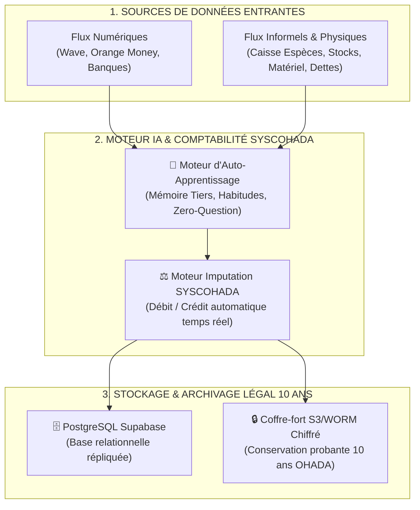
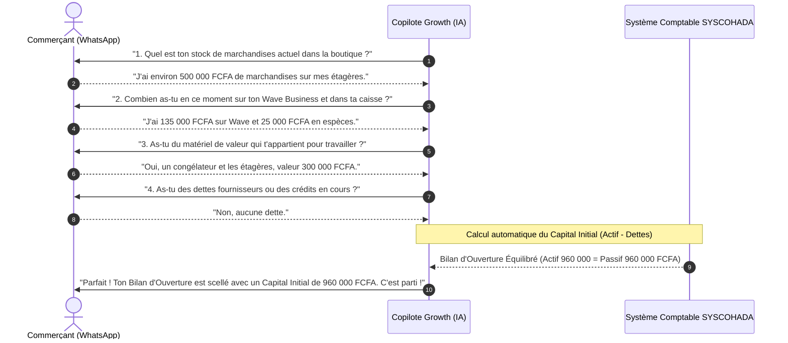
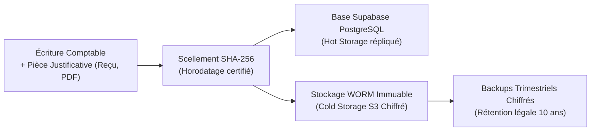

# 🌿 FEUILLE DE ROUTE STRATÉGIQUE & TECHNIQUE POST-MVP — GROWTH
## Plan Directeur : Automatisation, Rigueur Comptable, Flux Informels & Archivage Légal 10 Ans

---

## 🎯 Vision Globale & Enjeux Clés

Pour que l'intelligence artificielle de Growth devienne le copilote incontournable des PME et commerçants africains sur le terrain, la solution doit résoudre simultanément trois défis majeurs :
1. **La Friction Zéro :** L'IA ne doit plus poser sans cesse les mêmes questions au commerçant ; elle doit apprendre ses habitudes, ses fournisseurs et ses flux récurrents.
2. **L'Intégralité Comptable :** Réconcilier dans un même journal SYSCOHADA le monde **numérique** (Wave, Orange Money, banques) et le monde **physique/informel** (espèces, stocks de marchandises, matériel, dettes du carnet).
3. **La Force Probante & Pérennité 10 Ans :** Respecter l'obligation légale de l'Acte Uniforme OHADA imposant la conservation inaltérable des pièces justificatives pendant 10 ans minimum.

---

## 🏛️ PILIER 1 : Flux Numériques, Rigueur Comptable SYSCOHADA & Auto-Apprentissage IA

### 1.1. L'Auto-Apprentissage des Habitudes (Zero-Prompt Engine)
* **Le Problème Actuel :** Dès qu'un virement ou une note vocale arrive, demander à chaque fois *« C'est qui ? C'est quoi ? Pro ou perso ? »* lasse l'entrepreneur.
* **La Solution Déployée : Le Graphe de Mémoire Entreprise (`merchant_knowledge_graph`)**
  - **Table d'Apprentissage des Tiers :** Chaque numéro de téléphone ou nom est associé à son identité commerciale après la première confirmation.
    - *Exemple :* `77 123 45 67` = *Fournisseur Tissus Diallo (Compte 601)*.
    - *Comportement :* La 2e fois, l'IA catégorise directement sans demander :  
      `Virement 50 000 FCFA à Diallo détecté ➔ Achat Marchandises (601) imputé automatiquement.`
  - **Détection des Périodicités :** Les paiements effectués à intervalles réguliers (loyer boutique chaque 5 du mois, abonnement internet, facture Senelec) sont étiquetés « Charges Récurrentes » et traités sans confirmation.
  - **Séparation Automatique Pro / Perso :** Les montants envoyés à la famille ou les dépenses ménagères sont directement acheminés vers le **Compte Exploitant 104** (évitant de fausser le bénéfice net).

### 1.2. Rigueur des Écritures SYSCOHADA (Débit / Crédit)
Chaque opération est décomposée selon la stricte partie double :
* **Vente Wave :** Débit `5213 (Wave)` / Crédit `701 (Ventes Marchandises)`.
* **Achat Fournisseur Espèces :** Débit `601 (Achats)` / Crédit `571 (Caisse)`.
* **Règlement Dette Client :** Débit `5213 ou 571` / Crédit `411 (Clients)`.
* **Prélèvement personnel gérant :** Débit `104 (Exploitant)` / Crédit `5213 ou 571`.

---

## 📦 PILIER 2 : Gestion des Flux Non-Numériques & Actifs Physiques

La majorité des PME sénégalaises opère avec du cash, des stocks et du matériel. L'IA doit intégrer ces éléments avec une ergonomie intuitive.

### 2.1. La Caisse Espèces (Compte 571)
* **Point de friction :** Le commerçant ne va pas envoyer un vocal pour chaque paquet de mouchoirs vendu à 500 FCFA.
* **Méthode adoptée : La Clôture de Caisse Vocale Journalière (Point du Soir)**
  - Chaque soir à 19h30, Growth envoie un message automatique :  
    *« Bonsoir Fatou ! Combien d'espèces as-tu dans ton tiroir-caisse ce soir ? »*
  - Le commerçant répond en 5 secondes : *« J'ai 65 000 FCFA en cash »*.
  - L'IA calcule le différentiel par rapport au matin et génère l'écriture de vente espèces du jour en bloc.

### 2.2. Le Stock & Inventaire Marchandises (Classe 3 — Compte 311)
* **Enregistrement des Achats de Réapprovisionnement :** Facture photo ou audio ➔ Débit Compte 601 (Achats) / Sortie Trésorerie.
* **Valorisation Périodique du Stock :**
  - À la clôture mensuelle ou annuelle, saisie de l'inventaire physique : Débit `311 (Stock Final)` / Crédit `603 (Variation de Stock)`.
  - Permet de dégager la véritable marge brute commerciale réelle (Ventes - Coût des marchandises vendues).

### 2.3. Les Immobilisations & Matériel (Classe 2)
* **Identification des Investissements Durables :**
  - Achat d'un congélateur, d'une machine à coudre, de présentoirs ou d'une moto de livraison.
  - Imputation immédiate en Classe 2 (`241 - Matériel et Outillage`, `245 - Matériel de Transport`).
* **Amortissement Linéaire Automatique :**
  - L'IA calcule automatiquement l'annuité d'amortissement (ex: Congélateur 500 000 FCFA sur 5 ans = 100 000 FCFA/an de dotation au compte 681).

### 2.4. Le Carnet de Dettes & Créances (Comptes 411 / 401)
* Numérisation du cahier de crédit informel :
  - *« Modou a pris 3 sacs de riz à crédit (45 000 FCFA) »* ➔ Débit `411 (Client Modou)` / Crédit `701 (Vente)`.
  - Quand Modou paie ➔ Débit `571 ou 5213` / Crédit `411 (Client Modou)`.

---

## ⚡ PILIER 3 : Intégration Wave — API Partenaire vs Extraction Hybride

Comment automatiser la récupération des flux sans dépendre d'un accord bancaire long à obtenir ?

| Approche | Fonctionnement | Avantages | Inconvénients / Faisabilité | Recommandation Growth |
|---|---|---|---|---|
| **Option A : API Wave Business Partenaire Directe** | Accord officiel avec Wave CI/Sénégal pour brancher des webhooks directs de compte marchand. | 100% temps réel, zéro effort utilisateur, flux instantané. | Nécessite que Wave ouvre ses API privées ; réservé aux marchands Business officiels, exclusif aux comptes pro. | **Cible Moyen Terme (Mois 6+)** |
| **Option B : Ingestion Automatisée des Relevés PDF / CSV** | Le commerçant télécharge son relevé Wave Business (ou exporte ses SMS) et le glisse sur le dashboard ou dans WhatsApp. | Fonctionne **DÈS AUJOURD'HUI**, 100% légal, couvre l'historique sur plusieurs années. | Nécessite une action manuelle périodique (une fois par semaine ou par mois). | **Actif & Recommandé Immédiatement** |
| **Option C : Interception SMS & Notifications Push** | Transfert automatique du SMS de notification Wave/Orange Money sur la ligne WhatsApp Growth. | Quasi-temps réel, fonctionne pour les comptes marchands et particuliers. | Dépendant de l'application SMS de l'utilisateur. | **Complément Idéal pour le Quotidien** |

> [!TIP]
> **Stratégie Gagnante Retenue :**
> Déployer immédiatement l'approche **Hybride B + C** (Relevés périodiques + Transferts de notifications WhatsApp). Dès que le parc de PME actives atteint 500 boutiques, négocier avec la direction commerciale de Wave Sénégal une passerelle API Business officielle.

---

## 🚀 PILIER 4 : Onboarding Initial Intelligent (Le Bilan d'Ouverture en 3 Minutes)

Pour démarrer proprement la comptabilité d'une entreprise sans la noyer sous les questions techniques, l'onboarding se déroule en **4 questions vocales simples** :

* **Écriture comptable d'ouverture générée automatiquement :**
  - Débit `241 (Matériel)` : 300 000 FCFA
  - Débit `311 (Stock)` : 500 000 FCFA
  - Débit `5213 (Wave)` : 135 000 FCFA
  - Débit `571 (Caisse)` : 25 000 FCFA
  - Crédit `103 / 104 (Capital & Fonds commercial)` : **960 000 FCFA**

---

## 🔒 PILIER 5 : Archivage Légal & Conservation Pérenne sur 10 Ans (Norme OHADA)

L'article 19 de l'Acte Uniforme OHADA relatif au droit comptable stipule que **les livres comptables et les pièces justificatives doivent être conservés pendant 10 ans au moins**.

### 5.1. Architecture de Sauvegarde & Conservation

1. **Scellement Cryptographique SHA-256 :**
   - Chaque ligne d'écriture et chaque document justificatif reçoit une empreinte cryptographique unique `SHA-256`.
   - Si une écriture est altérée ultérieurement, la signature devient invalide.
2. **Stockage Immuable WORM (Write Once, Read Many) :**
   - Les reçus photographiés et les relevés bancaires importés sont stockés dans un conteneur cloud à écriture unique et lecture permanente, garantissant l'impossibilité de suppression accidentelle ou frauduleuse pendant 10 ans.
3. **Format Standard FEC Exportable :**
   - L'entrepreneur ou son cabinet ONECCA peut exporter à tout moment la totalité de ses 10 années de journaux au format **FEC (Fichier des Écritures Comptables)**, assurant la réversibilité totale des données en cas de contrôle fiscal de la DGID.

---

## 📅 PLAN DE MISE EN ŒUVRE OPÉRATIONNEL (Roadmap 4 Mois)

| Étape | Domaine | Livrable Concret | Durée |
|---|---|---|---|
| **Phase 1** | **Moteur d'Habitudes IA** | Développement du dictionnaire de mémoire client (`merchant_knowledge_graph`) pour supprimer 80% des questions répétitives sur les tiers récurrents. | Mois 1 |
| **Phase 2** | **Informel & Physique** | Module de clôture de caisse quotidienne (espèces 571), gestion simplifiée des stocks (311) et carnet de créances (411). | Mois 2 |
| **Phase 3** | **Onboarding Intelligent** | Protocole d'onboarding vocal en 4 étapes pour sceller le bilan d'ouverture et le capital initial sans formulaire. | Mois 3 |
| **Phase 4** | **Archivage Légal 10 Ans** | Mise en place de l'archivage WORM chiffré des pièces justificatives avec conformité stricte OHADA / CDP Sénégal. | Mois 4 |

---

### 💡 Conclusion Stratégique
En structurant ces 5 piliers, Growth ne se contente pas d'enregistrer des flux numériques : il devient **l'infrastructure financière intégrale de la PME informelle**, capable d'apprendre sans friction, de refléter la réalité physique du terrain et d'offrir des états comptables inattaquables pour les 10 prochaines années.

